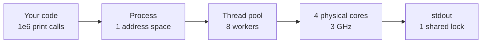
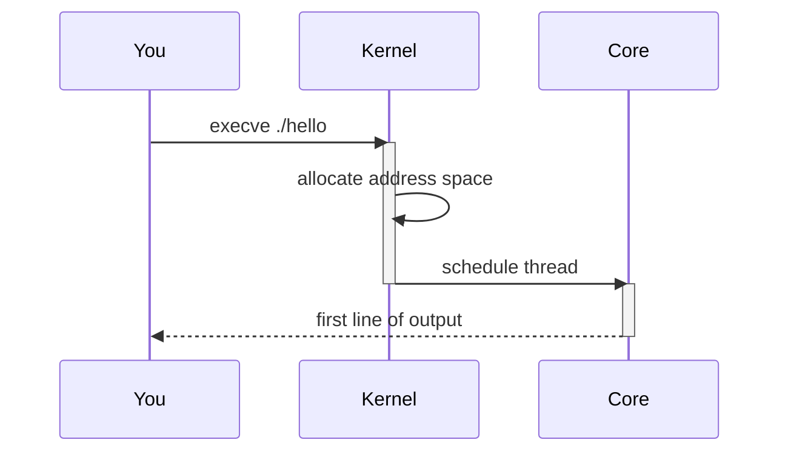

# Explain how it works

An explanation is a journey, not a taxonomy. The reader starts where they already are, does one
concrete thing, and meets each concept at the moment it first affects them.

The output is a note in the user's Obsidian vault. Chat gets the pointer, never the explanation.

`~/brain/learning/nodes-cores-processes-threads.md` is the structural reference for everything
below: read it first. It predates the diagram guidance in §4 and the language rule in §5.9, so
follow this file for diagrams and code, and follow the note for everything else. If it has been
deleted, the skeleton in the appendix is the spec.

## 1. Procedure

Do these in order. The note is not written in the order it is read.

1. **List `~/brain/learning/` first.** If a note already covers this topic, the work is an
   extension, not a new note: do §7, then come back to step 6.
2. **Agree the example** with the user (§2), and stop until they pick.
3. **Draft the body**: the chronological beats, §5's rules applied, diagrams as they are earned.
4. **Sweep the finished body** for every concept it leans on, in first-appearance order, and turn
   that sweep into the concept table. Deriving the table from the body is what makes the order
   true, and the sweep is what catches the concept that got hand-waved.
5. **Write the tail**: journey recap, quick answers, appendix.
6. **Write the file, then reply in chat** with three to five lines: the example, what the note
   covers, the path. Nothing else. Write the file in several passes rather than one call, since a
   single write at this size gets truncated.

Step 2 is the only pause. The pick *is* the plan: do not write a `plan.md` for a note, and do not
check back in between steps 3 and 6.

## 2. Propose the example, then stop

Offer **2-3 candidate scenarios**, one line each, as a numbered list, and wait. Do not start
writing. If the user has already named the example themselves, skip this and use theirs.

A candidate qualifies only if it is:

1. **Concrete, in the second person.** "You ask AWS for a `c7i.2xlarge` and print hello world a
   million times." A thing *you* do, with a verb. Not "consider a workload".
2. **Quantified.** A million, 16 GiB, 4 cores, 200 ms. The numbers do the teaching later.
3. **Big enough that the naive approach visibly breaks.** The break is where a concept earns its
   introduction, so the scale has to be past the point where the obvious approach stops working.
   Printing ten times teaches nothing, because at ten nothing is load-bearing.
4. **Single.** One example carries the whole note. Two means neither gets followed through.

If the conversation already contains the user's real code, repo or system, offer that as one of the
candidates. A real system beats an invented one.

---

## 3. Note structure

`~/brain/learning/<kebab-case-topic>.md`. No YAML frontmatter: open on the H1.

**Coverage is the target; length is a by-product.** Expect **12 to 17 numbered sections before the
tail and 25 to 40 concept rows** for a topic the size of the reference, which runs to 7,600 words
because it carries 38 concepts, not because long is good. The same 38 concepts in 5,000 words is a
better note. There is no minimum: a word count to reach is an instruction to pad.

Short is only a fault when it means beats were skipped. Scale the section count down for a smaller
topic, never the beats. Paragraphs are unwrapped, one line each, as in the reference.

### Title and opening

```markdown
# Nodes, cores, processes, threads: what actually happens when you run something

A single worked example, followed from the metal up: **you want to print "hello world" one million
times on an AWS node.** Every unit of execution and memory shows up in the order you would actually
meet it, and by the end the same example runs in parallel.

No prior context assumed.
```

The title says what actually happens when you do the thing. The opening states the example in bold,
in one sentence, and promises the shape of the journey. `No prior context assumed.` is literal:
keep it.

### The concept table

After the opening, separated by `---`, under `## Key concepts, in the order you meet them`. Three
columns: number, bolded concept, one line. Shape only, not quoted from the reference:

```markdown
| #   | Concept          | One line                                                              |
| --- | ---------------- | --------------------------------------------------------------------- |
| 1   | **Node**         | One whole computer: a box with CPU, RAM, disk, network card.          |
| 2   | **CPU (socket)** | The physical chip inside the node. A node usually has one or two.     |
| 3   | **Core**         | An independent execution engine. The only real source of parallelism. |
```

Rules:

1. **Ordered by first encounter**, not by importance and not by hierarchy.
2. **Every concept the journey turns on gets a row**, however small: pointer, syscall, context
   switch, buffering. Supporting vocabulary introduced and used once inside a single section does
   not. The test is whether a later section depends on it.
3. **One line as rendered.** Two short sentences is fine, a paragraph is not. The gloss is a
   handhold to come back to, not the explanation.
4. The number in the table is not the section number. Several concepts usually land in one section.

### The body

Numbered `##` sections, one per beat of the journey, separated by `---`. Each section:

1. Opens where the user is standing, not where the machine is.
2. Introduces its concepts at the moment they first bite.
3. Carries **at least one bolded punchline sentence**: the one thing to remember, placed where the
   argument lands, which is often not the last line. A long section carries two or three. Concept
   names are also bolded inline on first use, throughout.

A section that has to slow down splits into `###` subsections, each a named sub-beat. This is where
the hardest material goes: `### The stack: a pile of plates`, `### The full hierarchy`.

### The tail

Three closing sections. The first two continue the body's numbering; the appendix does not.

1. `## N. The whole journey in one pass` - the entire example again as a numbered list, one line
   per beat, bolding each concept as it recurs. No new concepts. This is what gets re-read in six
   months.
2. `## N+1. Quick answers` - the questions they will still have and the misreadings they will still
   be carrying. Format is a bolded question and its answer in one paragraph:

   ```markdown
   **Is a node one CPU?** No. A node is one whole computer, running one kernel. It normally holds
   one physical CPU chip, and that chip holds many cores.
   ```

3. `## Appendix: numbers worth memorising` - for a topic with real costs, a three-column table,
   `Operation | Time | Relative`, where the relative column normalises everything to the cheapest
   row (`1x`, `300x`, `3,000,000x`). The multipliers are the point: they are what make future
   estimates possible. Close on one bolded sentence reading the table.

   **Where the topic has no meaningful cost table, do not invent one.** The appendix becomes
   whatever the reader will actually come back for, a state table or a side-by-side, and is dropped
   if there is nothing.

---

## 4. Diagrams

At least one diagram per major structural claim, which in practice is most sections but not all. A
diagram earns its place by showing something the prose cannot say in one line; one that restates
the paragraph above it is noise. Put quantities in the labels: `4 cores`, `16 GiB`, `1e6 calls`,
never a bare `cores`, `RAM`, `calls`.

Three kinds, picked by what they are actually good at. **The first two carry most of the work.**

### ASCII, for space, nesting and layout

Fenced plain blocks. This is the default, and it is what the reference uses throughout: containment,
memory maps and hierarchies are exactly what mermaid is worst at, and forcing them into it produces
something worse than the ASCII. It also cannot break.

````markdown
```
NODE  (one computer, 16 GiB RAM, 4 cores / 8 vCPU)
│
├── RAM: bytes 0 .......................................... 16,000,000,000
│
└── PROCESS  (private slice of those bytes)
    ├── code + constants   (your compiled instructions)
    ├── HEAP               <-- one per process, SHARED by every thread
    ├── thread 1 ── STACK  <-- private to this thread
    └── thread 2 ── STACK  <-- private to this thread
```
````

Timelines go here too. A staggered ASCII bar chart says "worker 2 waited" as well as anything and
survives every renderer:

````markdown
```
        0s          30s         60s
work 1  [--compute--][---wait---]
work 2  [---wait----][--compute-]
                     ^ both wanted the same stdout lock
```
````

### Tables, for two things being confused with each other

Whenever the reader's likely error is conflating two things, put them side by side. This is a
diagram in the sense that matters: it makes the difference visible at a glance.

```markdown
| Per thread (private) | Per process (shared by all its threads) |
| -------------------- | --------------------------------------- |
| Stack                | Heap                                    |
| Registers            | Global and static variables             |
```

### Mermaid, for flow and sequence

Obsidian renders mermaid natively with no plugin, so use it where there is a genuine flow of
control or a who-calls-whom over time. These are the cases ASCII handles badly.

**One `sequenceDiagram` covering the main chronology is usually right, and is the diagram to reach
for first.** Beyond that, mermaid is optional: everything else defaults to ASCII or a table.

````markdown

````

````markdown

````

Rules that stop it failing to render:

1. **Use `flowchart` and `sequenceDiagram` only.** Every other type, `gantt` included, has changed
   parsing behaviour between the mermaid versions Obsidian ships. A diagram that renders as a red
   error box, or silently plots the wrong thing, is worse than no diagram, and neither can be
   caught by re-reading the note.
2. Quote any label containing spaces, punctuation, parentheses or `>`: `A["1e6 calls (approx)"]`.
3. Use `<br/>` for line breaks inside a label, never a real newline.
4. Declare a direction on every `flowchart` (`LR` or `TD`) rather than relying on the `TB` default.
5. Balance every `activate` with a `deactivate`.
6. Keep it under about 15 nodes. Past that it is a hairball and wants splitting in two.

---

## 5. Content rules

**Reading time is the scarce resource, so every sentence has to teach.** The note is long only
because the topic has many concepts; it is never long because the prose is loose. Density is the
goal, and the reader should be able to understand a concept and move on.

How that is achieved, concretely:

- **Answer first, elaborate second.** Lead each section and each paragraph with the conclusion. A
  reader who stops after one sentence should still be right.
- **Delete throat-clearing.** "It is worth noting that", "In order to", "As we can see", "Let us
  consider", "Simply", "Basically". They carry nothing.
- **No section preamble and no section summary.** Do not say what a section will cover, then cover
  it, then say what it covered. The journey recap is the only recap in the note.
- **A table or a diagram wherever it beats prose.** A three-row table replaces a paragraph and is
  read in a second.
- **One idea per sentence.** Two clauses joined by "and" are usually two sentences, or one
  sentence and a deletion.
- **Cut every sentence that survives its own deletion.** Read the draft back and remove anything
  whose absence loses nothing. This pass always finds something.

Cutting words is not cutting concepts. If a concept the journey turns on has to go to hit some
length, the note was structured wrong, not written long.

The rules below are how the content itself behaves.

1. **Follow the one example to the end.** Every section is still the same million prints. When a
   variant genuinely matters, such as one node versus a cluster, run *that same example* down the
   other path. Never retreat into abstraction to cover both.
2. **Apply, then name.** Show the thing happening, then say what it is called. A definition read
   before it is needed is not retained.
3. **Analogies are allowed when they are structurally true and never have to be retracted.** A pile
   of plates *is* a stack, exactly, and carries a whole section. An analogy you have to walk back
   later has taught the reader something wrong. Never open on one.
4. **Real numbers, not adjectives.** "A core at ~3 GHz does roughly three billion simple steps a
   second" beats "cores are very fast". Estimate and say you estimated rather than writing "many".
5. **Name the misreading and kill it.** Where a common wrong model exists, state it and correct it:
   "A common misreading is that threads are isolated. **They are not.**" The reader usually arrives
   holding the wrong model, and unsaid corrections do not land.
6. **Show the naive version failing before the good one.** The fix only means something once the
   break is visible.
7. **Defer forward rather than hand-wave.** When a concept must be named before its beat, gloss it
   in one clause and point at where it is done properly: "the **scheduler** hands it a core, §9
   covers it". Never leave a named thing unexplained.
8. **Code blocks are as short as makes the point**, a dozen lines at most and often two.
9. **Rust by default, Python where the domain is Python's.** In priority order:
   1. The language of the user's actual code, when the explanation is about a real system in front
      of you. A real codebase beats any default.
   2. **Rust** otherwise. It makes ownership, allocation, copying and concurrency visible in the
      source, which is usually the thing being explained.
   3. **Python** where it is genuinely the domain's language: ML, data, numerics, notebooks,
      scripting and glue. A torch training loop written in Rust teaches nothing about training
      loops.
   4. The one language the concept exists in, when it only exists in one. The GIL is Python, the
      borrow checker is Rust, and neither has a sensible translation.

   Where a contrast is the whole point, show both, shortest possible, side by side: the same eight
   lines in Rust and Python say more about `Arc<Mutex<T>>` versus the GIL than a paragraph does.
   Never a third language: C or Go as a "neutral" illustration is one more thing to read past.

## 6. Never

1. Open with definitions or history.
2. Switch examples midway, or add a second example to cover a case.
3. Use a layer diagram in place of a sequence of events. Layers say what exists; the reader needs
   what happens.
4. Say something is "handled by the runtime", "managed automatically", or "under the hood" without
   saying what is done and by which part.

## 7. Extending an existing note

The default outcome for a follow-up question. Do not create a second note on a topic that already
has one, and do not append the answer to the end as an afterthought.

1. Slot the new material into the journey at the beat where it belongs.
2. Add its concepts to the table **in encounter order**, renumbering the rows below.
3. Update the journey recap and the quick answers if the addition changes either.

**If the existing note does not already have this structure it is raw material, not a note.** The
vault holds scratch files and study plans that share a topic name; rebuild one into the full shape
from §3 rather than appending to it. Either way, finish at step 6 of §1.

---

## Appendix: the assembled shape

Blank lines around every `---` are load-bearing. A `---` on the line directly below text is a
setext heading, not a rule, and it silently swallows the line above it.

```
# <Topic>: what actually happens when you <do the thing>

<one bold sentence naming the example>

No prior context assumed.

---

## Key concepts, in the order you meet them

<3-column table, 25-40 rows, encounter order>

---

## 1. <where the user is standing>
## 2. <the next beat>          <- concepts as they bite, a diagram or table where it earns
   ### <sub-beat>              <- only where a section has to slow down
## 12. <the naive version, failing>
## 13. <the fix>
## 14. <what it looks like when it ends>

---

## 15. The whole journey in one pass
## 16. Quick answers
## Appendix: numbers worth memorising
```
